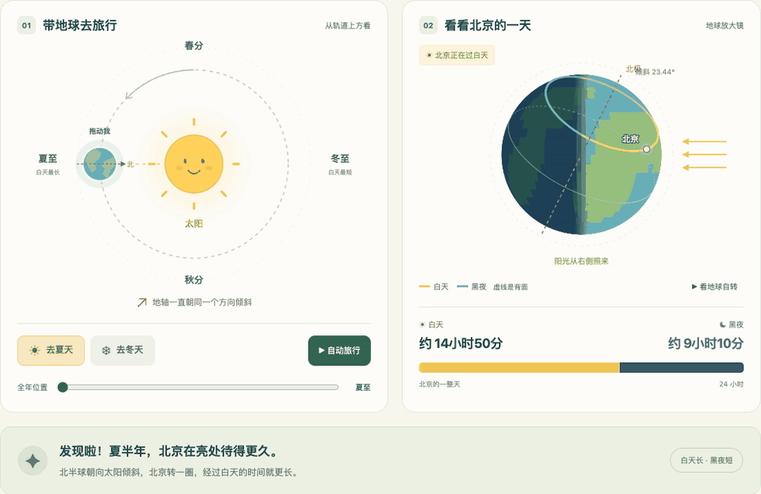
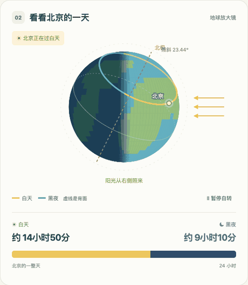
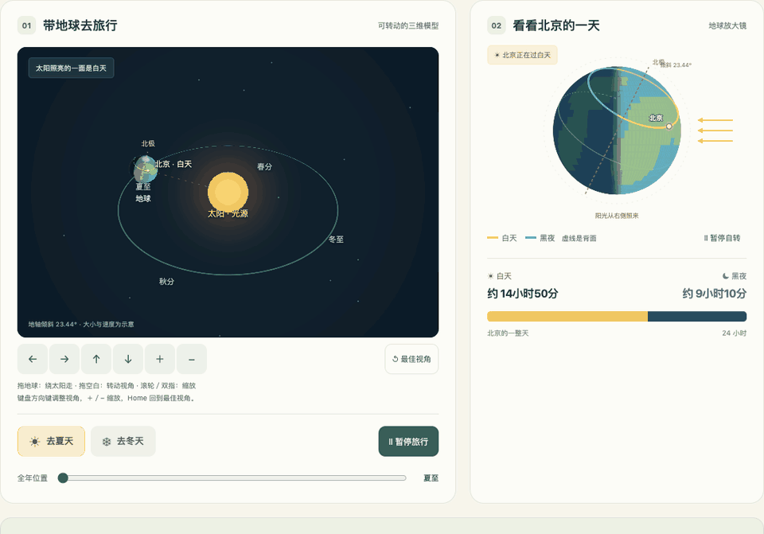

# Little Daylight

**小小天文家：为什么夏天的白天比冬天长？**

An interactive Earth–Sun demo that helps five-year-olds discover why summer days are longer than winter days in Beijing.

这是一个**给 5 岁幼儿园小朋友讲解昼夜长短变化的互动 Web 项目**。以北京为观察地点，让孩子拖动地球、观察太阳光照，发现：为什么夏天可以在天亮的时候玩得久一点，冬天天却黑得早？

适合老师在幼儿园投屏演示，也适合家长陪孩子一起探索。孩子不需要记住公式，只需要看一看、拖一拖，比较北京在白天和黑夜分别待多久。

## 先看看它怎么玩

以下动图来自实际页面。为了便于预览，播放时间经过压缩；公转与自转的速度不按真实时间比例展示。

### 1. 拖动地球，比较夏天和冬天

地球沿轨道移动时，北京的白天、黑夜长条和时长一起变化。黄色表示白天，蓝色表示黑夜；点击“去夏天”和“去冬天”也能直接比较。



### 2. 盯住北京，看它怎样进入白天和黑夜

地球自己转动，北京也跟着转。经过太阳照亮的一面就是白天，进入背向太阳的一面就是黑夜。黄色、蓝色轨迹显示北京一天中经过的亮处和暗处，虚线表示地球背面。



### 3. 换成 3D 视角，看公转、自转和太阳光照

太阳是光源，地球一边自转，一边绕太阳公转。地轴始终朝同一个方向倾斜，地球走到不同位置时，北京一天中经过亮处的时间便不同。3D 模型与右侧北京放大图、昼长读数保持同步。



## 怎么打开

下载或复制整个项目文件夹，**双击 [index.html](index.html)**，用现代浏览器打开即可。

无需安装运行依赖、启动服务器或联网。保留 HTML、CSS、JavaScript 文件的相对位置。3D 视角需要浏览器支持 WebGL；不支持时会提示切换到仍可使用的“讲解示意图”。

| 想做什么 | 怎样操作 |
| --- | --- |
| 比较夏天、冬天 | 点击“去夏天”“去冬天”，或拖动地球、调整全年位置滑块 |
| 看完整公转过程 | 点击“自动旅行”，再次点击暂停 |
| 看北京经过白天和黑夜 | 点击“看地球自转”，可单独暂停自转 |
| 切换三维模型 | 点击“3D 太空视角” |
| 改变三维观察角度 | 拖动空白处，或点击画面下方的方向按钮 |
| 放大、缩小三维模型 | 使用滚轮、双指缩放或“＋／−”按钮 |
| 视角转乱了 | 点击“最佳视角” |

也支持键盘：Tab 聚焦全年位置滑块后，用方向键改变季节位置；聚焦 3D 画面后，用方向键转动视角、＋／− 缩放、Home 回到最佳视角。系统开启“减少动态效果”时，初始保持静止，可手动开始播放。

## 给老师和家长：用几分钟讲给孩子听

可以先这样说：

> 地球像一个歪着身子转的球，歪的方向一直不变。我们住在北京。地球走到夏天的位置时，北京转一圈，在阳光里待得更久；走到冬天的位置时，在阳光里待的时间更短。所以，夏天白天长，冬天白天短。

1. **先找北京。** 暂停公转，只播放自转，让孩子观察北京什么时候亮、什么时候暗。
2. **去夏天。** 问：“北京是在亮处待得久，还是在暗处待得久？”一起看黄色长条。
3. **再去冬天。** 问：“黄色长条变长了，还是变短了？”对比两种季节。
4. **最后看 3D。** 转动观察视角，指给孩子看始终倾斜的地轴，再让孩子亲手拖动地球。

希望孩子带走的是三个发现：**地球自转带来白天和黑夜；地球斜着身子绕太阳走；北京夏天经过亮处的时间比冬天长。** 不必要求孩子记住纬度、倾角或计算过程。

## 科学说明

本项目解释的是**北京的季节变化**，不是所有地方都一样。北京位于北半球，南半球的季节与北京相反。

- 北京纬度取北纬 39.9°，地轴倾角取 23.44°。几何模型下，夏至白天约 **14 小时 50 分**，冬至约 **9 小时 10 分**，春秋分各约 **12 小时**。给孩子讲解时，可以概括成“夏天约 15 小时，冬天约 9 小时”。
- 昼长未计大气折射与太阳视半径，属于教学近似值，不能作为精确日出日落时间。
- 四季与地轴倾斜及地球公转有关，**不是因为夏天离太阳更近**。公转过程中地轴在空间中的朝向保持不变。
- 原理图与放大图的观察方向不同，因此地轴投影不同。3D 模型可以自由转动视角；太阳固定在原点，地球附近的太阳光按平行光处理，与昼长计算使用同一方向。
- 公转和自转可以独立暂停。暂停自转后，改变公转位置会保持地表的空间朝向，不会额外转动地表。
- 圆形轨道、天体大小、距离、速度以及陆地轮廓均为示意，不按真实比例展示。

## 项目结构与验证

项目使用原生 HTML、CSS、JavaScript、SVG 与 WebGL，无第三方运行依赖。

| 文件 | 用途 |
| --- | --- |
| `index.html` / `styles.css` | 中文演示页面与响应式布局 |
| `daylight.js` | 北京昼长、地轴和受光几何计算 |
| `app.js` | 页面状态、交互与自转／公转动画 |
| `space.js` | 3D 渲染、视角控制与三维拖动 |
| `docs/media/` | README 使用的实际页面动图 |
| `tests/` | 数学自检和浏览器回归测试 |

数学自检及语法检查只需 Node：

```sh
node --check daylight.js
node --check app.js
node --check space.js
node tests/daylight.test.cjs
node tests/space.test.cjs
```

可选的浏览器回归测试需要本机已有 Python Playwright 和 Chrome：

```sh
python tests/browser.test.py
python tests/space.browser.py
```

macOS 默认使用 `/Applications/Google Chrome.app/Contents/MacOS/Google Chrome`；其他位置可通过 `CHROME_PATH` 环境变量指定。未找到该路径时使用 Playwright 自带的 Chromium。

测试覆盖昼长计算、三维投影、受光、自转与公转独立性、本地文件打开、鼠标／触屏模拟拖动、双指缩放、键盘操作、减少动态效果、响应式布局，以及不支持 WebGL 时的回退。测试截图输出到 `artifacts/`。

真实触屏设备、Safari、屏幕阅读器及低性能设备尚未验证。全年位置滑块到达 360° 时会回到代表同一季节位置的 0°，不影响地球拖动和昼长计算。
